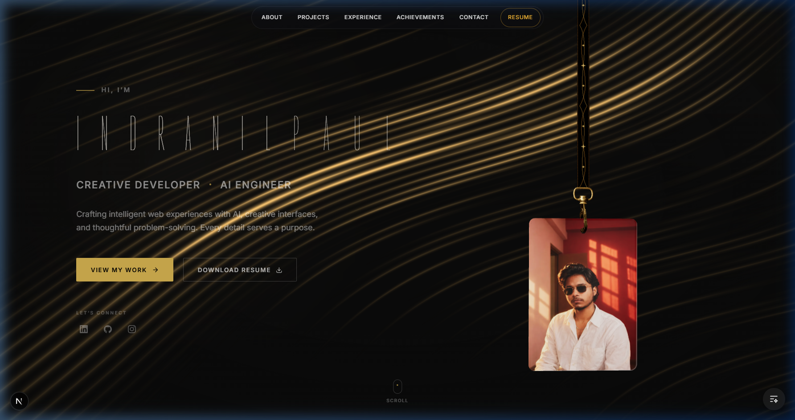
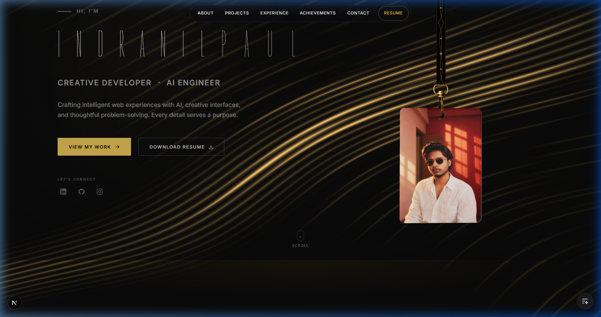
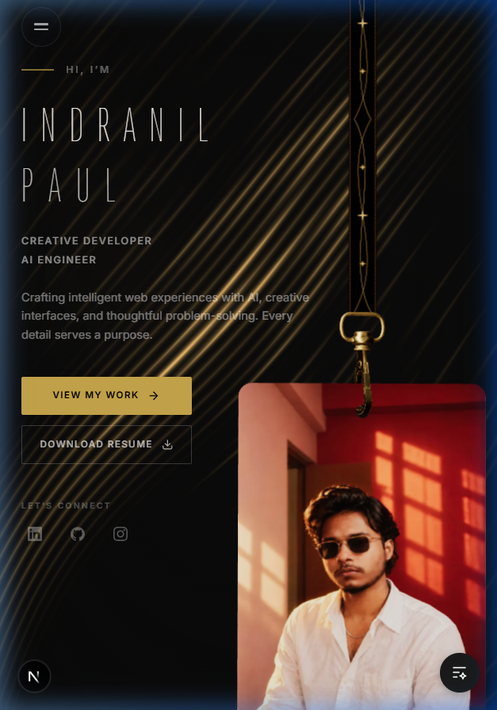
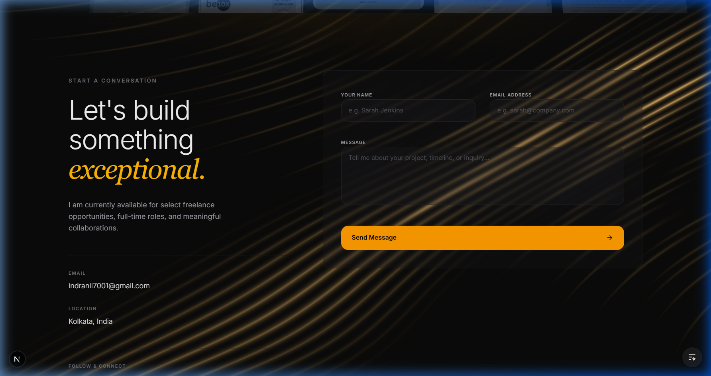
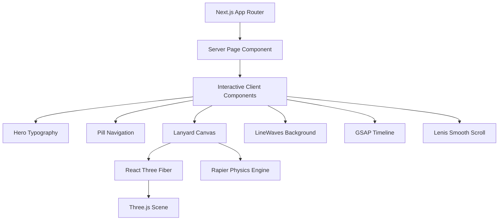

# Indranil Paul — Interactive Portfolio

An immersive developer portfolio combining cinematic UI, interactive 3D physics, and performance-focused frontend engineering.

[**Live Website**](https://indranilpaul.dev) · [**Source Code**](https://github.com/indraaaa29/My-Portfolio)



## Project Snapshot

| Category | Technology |
|---|---|
| **Type** | Personal Portfolio |
| **Framework** | Next.js 16 (App Router) |
| **Language** | TypeScript |
| **Rendering** | React 19 + Three.js |
| **Physics** | Rapier (@react-three/rapier) |
| **Animation** | GSAP |
| **Scrolling** | Lenis |
| **Deployment** | Vercel (Ready) |

## Technical Highlights

- **Server-rendered application shell**: Optimized App Router architecture maximizing initial render speed.
- **Interactive 3D physics**: A responsive, physics-based developer lanyard integrated directly into the DOM flow.
- **Responsive Lanyard interaction**: Precise rigid-body constraints adapted for both ultra-wide and mobile viewports.
- **GPU-aware visual effects**: Hardware-accelerated CSS and WebGL elements offloading the main thread.
- **Smooth scrolling**: Native-feeling momentum scroll built on Lenis.
- **Accessible navigation**: Focus-visible rings, semantic HTML, and proper keyboard navigation indexing.
- **SEO infrastructure**: Fully configured metadata, `robots.txt`, and automated `sitemap.xml`.
- **Production-focused validation**: Zero ESLint warnings, strictly typed interfaces, and optimized image delivery.

## Why This Portfolio Is Different

Most portfolios lean into either strict minimalism or unoptimized visual bloat. This project was engineered to prove that a **highly visual, interactive web experience does not require sacrificing performance or accessibility**.

Key differentiators include an **interactive physics-based Lanyard** that responds to pointer gestures and gravity without blocking the main React thread, a **cinematic visual system** driven by centralized design tokens rather than ad-hoc inline styles, and **performance optimization** that respects users via automatic `prefers-reduced-motion` fallbacks.

## Visual Showcase

| Desktop Experience | Interactive Lanyard |
| :---: | :---: |
|  |  |

| Mobile Viewport (390px) | Contact & Socials |
| :---: | :---: |
|  |  |

## Interactive Lanyard

### What it is
A physics-based interactive identity card and strap spanning the hero section.

### How it works
The lanyard is driven by `React Three Fiber` mapping declarative React state to a `Three.js` scene graph. We use `@react-three/rapier` to apply physical properties to a chain of rigid bodies. **Spherical joints** link the strap segments together, while a **rope joint** bounds the maximum distance of the badge. Pointer interaction applies localized kinetic impulses to the rigid bodies, allowing the card to be dragged or tossed while naturally settling back via gravity and damping.

### Why it exists
It breaks the rigid, expected layout of a standard web resume. It invites tactile interaction immediately upon load, creating a playful, memorable first impression while contrasting cleanly against the cinematic, serious tone of the background.

### Performance considerations
Generating textures procedurally at runtime was causing severe WebGL overhead. This was refactored into a static optimized PNG (`lanyard-premium.png`), drastically cutting initialization time and completely eliminating texture-generation stutter.

### Responsive behavior
The lanyard's anchor points, mass, and bounding boxes are dynamically calculated based on the viewport, ensuring that it remains reachable on a 390px mobile screen without clipping, and scales proportionately on a 1920px 4K display.

## How It Works

1. **Next.js renders the portfolio shell** entirely on the server for instant First Contentful Paint.
2. **Interactive client components initialize** only where user interaction dictates (like the Navigation Pill and the Lanyard).
3. **Hero establishes the visual identity** using variable fonts (`TextPressure`) mapped to container queries.
4. **Three.js/R3F powers the interactive Lanyard**, spinning up an isolated WebGL context.
5. **Rapier handles physics**, mapping pointer events to rigid-body impulses.
6. **GSAP/Lenis provide motion and scrolling**, mapping DOM element positions to the smooth momentum scroll progression.
7. **Responsive logic adapts the experience** gracefully down to 320px screens.

## Architecture Diagram



## Engineering Decisions

| Decision | Reason |
|---|---|
| **Server Component root** | Reduce unnecessary client-side JavaScript bundle payload. |
| **Static Lanyard texture** | Avoid expensive runtime texture generation stalling the main thread. |
| **React Three Fiber** | Integrate complex 3D rendering gracefully with React component lifecycles. |
| **Rapier Physics Engine** | Provide deterministic, high-performance rigid body calculations. |
| **Lenis over native scroll** | Synchronize GSAP ScrollTrigger animations to a unified hardware-accelerated momentum. |
| **Centralized Design Tokens** | Enforce a consistent cinematic visual system globally. |
| **Reduced Motion Fallback** | Ensure accessibility for users with vestibular sensitivities by pausing physics. |

## Tech Stack

**Core**
- `Next.js 16.2`
- `React 19`
- `TypeScript`

**3D / Interaction**
- `Three.js`
- `@react-three/fiber`
- `@react-three/drei`
- `@react-three/rapier`

**Motion**
- `GSAP 3.15`
- `Lenis`

**Styling**
- `Tailwind CSS 4`
- Standard Vanilla `CSS`

## Responsive by Design

The portfolio is engineered to look visually flawless regardless of device size. Mobile composition moves the interactive Lanyard precisely out of the way of the primary typography while retaining full interaction. Font sizes and spacing rely on `clamp()` and responsive container measurements rather than fixed breakpoints, ensuring complete fluidity.

## Performance Engineering

- **Server/client boundary optimization**: `page.tsx` and `layout.tsx` are strictly Server Components. The WebGL context is pushed deeply into the client-side leaf component (`Lanyard.tsx`).
- **Static texture loading**: The lanyard strap is pre-baked into a static asset, preventing blocking runtime calculations.
- **Reduced redundant rendering**: `useSyncExternalStore` handles resize and scroll progress events to prevent cascading React state updates on every scroll tick.
- **Image optimization**: Heavy assets are converted to `webp` and delivered through Next.js optimized routing.

## Accessibility

- **Keyboard Navigation**: The entire site can be navigated cleanly using the `Tab` key.
- **Focus-visible indicators**: Elegant, customized focus rings appear only for keyboard users, leaving mouse users with an uninterrupted cinematic aesthetic.
- **Semantic HTML**: Proper `<header>`, `<main>`, `<nav>`, and `<section>` landmarks.
- **Reduced-motion support**: Animations respect OS-level motion preferences, falling back gracefully.

## SEO

The project is thoroughly production-aware for search engines:
- `metadataBase` dynamically resolves to `https://indranilpaul.dev`
- Comprehensive dynamic `<head>` metadata (titles, descriptions, OpenGraph).
- Automated `robots.txt` configuration.
- Automated `sitemap.xml` mapping.

## Project Structure

```text
src/
├── app/
│   ├── globals.css
│   ├── layout.tsx
│   ├── page.tsx
│   ├── robots.ts
│   └── sitemap.ts
├── components/
│   ├── background/
│   ├── hero/
│   ├── navbar/
│   ├── portfolio/
│   └── reactbits/
│       └── Lanyard.tsx
├── data/
│   ├── achievements.ts
│   ├── portfolioData.ts
│   └── projects.ts
├── hooks/
│   └── use-media-query.ts
└── lib/
    ├── config.ts
    ├── design-tokens.ts
    ├── scroll-lock.ts
    └── utils.ts
```

## Getting Started

```bash
# Clone the repository
git clone https://github.com/indraaaa29/My-Portfolio.git

# Enter the directory
cd My-Portfolio

# Install dependencies
npm install

# Start the development server
npm run dev
```

Open [http://localhost:3000](http://localhost:3000) with your browser to see the result.

## Production / Deployment

```bash
# Verify type safety
npx tsc --noEmit

# Ensure strict linting compliance
npm run lint

# Generate optimized production bundle
npm run build

# Start the production server
npm run start
```

## Engineering Evolution

### Architecture
The project evolved from a highly client-heavy SPA into a strict Next.js App Router architecture, moving the root wrapper entirely to the server and cleanly defining interactive client components.
### Performance
Early iterations involved generating the physical strap texture procedurally via Canvas API, which choked mobile rendering. This was refactored into an optimized static image texture.
### Code Quality
React Hooks that aggressively re-rendered components on scroll (`useScrollProgress`) were stripped out, delegating animation entirely to GSAP timelines.
### Source Cleanup
All unused experimental features, bloated utilities, and orphaned component directories were purged, creating a minimal, maintainable source tree.

## About

I am a Computer Science & Engineering student focused on AI/ML and software development, with a deep interest in building experiences that bridge the gap between heavy technical logic and beautiful interfaces.

This repository represents my approach to combining **engineering + design + interaction + visual storytelling**. It isn't intended to be just a static collection of links—it’s an interactive representation of how I build and think. The physics-based 3D Lanyard, cinematic visual direction, and hardware-accelerated motion are entirely intentional, built to prove that highly creative web experiences can still be executed with strict performance-conscious implementation.

### What I’m Into
- 💻 **Software Engineering**
- 🤖 **AI & Machine Learning**
- 🎨 **UI/UX & Creative Development**
- 🌐 **Interactive Web Experiences**
- 📷 **Photography & Visual Storytelling**
- 🚀 **Building & Experimenting**

### Currently Building
I am currently focused on engineering robust full-stack architectures and exploring ways to integrate intelligent AI models directly into scalable, production-ready web platforms.

> *I like building things that perform beautifully, look intentional, and leave a lasting impression.*

**Find me:** [Portfolio](https://indranilpaul.dev) · [GitHub](https://github.com/indraaaa29) · [LinkedIn](https://www.linkedin.com/in/indranil-paul-ai/)
